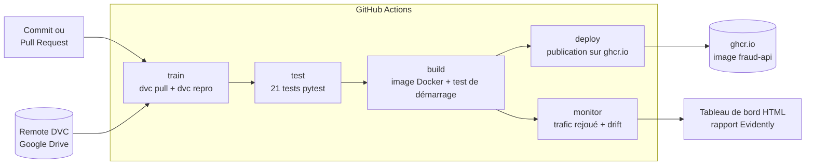
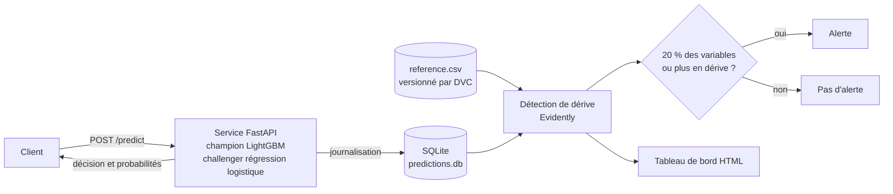
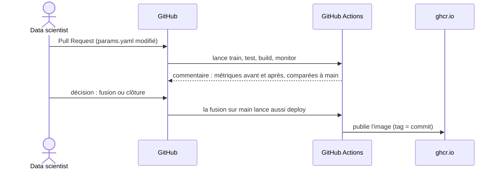

# Surveillance d'un modèle de détection de fraude financière

[](https://github.com/TGerardSOKPETIN/fraude-drift-monitoring/actions/workflows/ci-cd-monitoring.yml)


Chaîne complète de mise en production et de surveillance d'un modèle de scoring de fraude bancaire : service de prédiction en temps réel, versioning des données et des modèles, pipeline CI/CD, détection de dérive (*data drift*) sur le trafic réellement observé et tableau de bord d'alerte. Les données sont celles du cas Poundbank (transactions bancaires, période de référence puis période de production).

Travail réalisé par Gérard Sokpetin, sous la supervision de M. Mihoubi.

## Ce que le projet apporte

| Besoin | Réponse apportée | Où |
|---|---|---|
| Scorer une transaction en temps réel | Service FastAPI, modèle champion LightGBM et challenger régression logistique | [`application_poussee/apps/`](application_poussee/apps/inference_app.py) |
| Retrouver quelles données et quels paramètres ont produit un modèle | Pipeline DVC, paramètres dans `params.yaml`, remote Google Drive | [`dvc.yaml`](dvc.yaml), [`params.yaml`](params.yaml) |
| Livrer un service reproductible | Image Docker, validée par un test de démarrage | [`application_poussee/Dockerfile`](application_poussee/Dockerfile) |
| Détecter qu'un modèle se dégrade en production | Journalisation des appels, drift Evidently sur les logs réels, alerte à seuil | [`application_poussee/monitoring/`](application_poussee/monitoring) |
| Éviter les régressions | 21 tests automatisés, comparaison des métriques avec `main` sur chaque Pull Request | [`application_poussee/tests/`](application_poussee/tests) |
| Voir l'état du modèle d'un coup d'œil | Tableau de bord HTML généré à chaque exécution de la CI | [`build_dashboard.py`](application_poussee/monitoring/build_dashboard.py) |

## Architecture

### Pipeline CI/CD

Chaque modification passe par les cinq étapes ci-dessous (GitHub Actions). La publication de l'image n'a lieu que sur la branche `main`.



### Service et surveillance en production

Le service journalise chaque prédiction (variables d'entrée, sorties, version du modèle, latence). Cette base alimente la détection de dérive, qui compare le trafic observé au jeu de référence.



### Cycle de vie d'un changement

Un changement de modèle (par exemple un hyperparamètre) suit toujours le même chemin, et chaque étape laisse une trace consultable.



## Pipeline CI/CD

Définition : [`.github/workflows/ci-cd-monitoring.yml`](.github/workflows/ci-cd-monitoring.yml). Déclenchement à chaque push sur `main`, chaque Pull Request, à la demande, et chaque lundi pour une surveillance régulière.

| Étape | Rôle | Ce qu'elle garantit |
|---|---|---|
| `train` | Récupère les données sur le remote DVC, relance `dvc repro` | Le modèle se reconstruit depuis zéro, sans la machine de l'auteur |
| `test` | Lance la suite pytest | Le service, le calcul des variables et les métriques du modèle restent corrects |
| `build` | Construit l'image Docker, la démarre, appelle `/health` et `/predict` | L'image livrée fonctionne réellement |
| `deploy` | Publie l'image sur `ghcr.io` (tags : commit et `latest`), branche `main` seulement | Une version identifiée et récupérable existe pour chaque commit validé |
| `monitor` | Démarre l'image, rejoue 300 transactions, analyse la dérive, produit le tableau de bord | La surveillance elle-même est testée à chaque exécution |

Sur une Pull Request, la CI publie aussi en commentaire le tableau des métriques du modèle comparé à `main`. Les vérifications au vert disent que le modèle fonctionne, ce tableau dit s'il est meilleur.

## Démarrage rapide

Prérequis : Python 3.11, Docker, et l'accès au remote DVC (dossier Google Drive à partager avec chaque contributeur).

```bash
git clone https://github.com/TGerardSOKPETIN/fraude-drift-monitoring.git
cd fraude-drift-monitoring
python -m venv .venv
source .venv/bin/activate          # sous Windows : .venv\Scripts\Activate.ps1
pip install -r requirements.txt
pip install -r application_poussee/apps/requirements.txt -r application_poussee/tests/requirements.txt
pip install pyyaml "dvc[gdrive]" "cryptography<44"
```

Récupérer les données, entraîner et tester :

```bash
dvc pull data/reference.csv data/analysis.csv
dvc repro                                    # entraîne champion et challenger
python -m pytest application_poussee/tests -q
```

Lancer le service et la surveillance :

```bash
docker compose up --build -d                 # service sur http://localhost:8000/docs
python application_poussee/monitoring/replay_traffic.py --n 300
python application_poussee/monitoring/run_drift_on_logs.py
python application_poussee/monitoring/build_dashboard.py
```

Le tableau de bord est écrit dans `application_poussee/reports/monitoring/dashboard.html`. Sous Windows PowerShell, utiliser `curl.exe` à la place de `curl` pour appeler l'API en ligne de commande.

## Service de scoring

| Route | Rôle |
|---|---|
| `GET /health` | État du service et modèles chargés |
| `GET /model-info` | Version, algorithmes, seuil de décision, variables attendues |
| `POST /predict` | Probabilité de fraude (champion et challenger) et décision |

Exemple d'appel :

```bash
curl -X POST http://localhost:8000/predict \
  -H "Content-Type: application/json" \
  -d '{"time_since_login_min": 15, "transaction_amount": 120.5, "transaction_type": "PAYMENT", "is_first_transaction": false, "user_tenure_months": 24}'
```

La décision (`FRAUDE_SUSPECTEE` ou `LEGITIME`) repose sur le champion avec un seuil de 0,5. Le challenger est renvoyé à titre de comparaison. Seules les variables utilisées par le modèle sont journalisées : pas d'identifiant client, pas de donnée superflue.

## Surveillance de la dérive

Chaque variable est comparée au jeu de référence avec la distance de Wasserstein normalisée (variables numériques) ou la distance de Jensen-Shannon (variables catégorielles), seuil de 0,1 par variable. Une alerte est déclenchée quand 20 % des variables, ou plus, dépassent leur seuil. Avec cinq variables, cela revient à alerter dès qu'une seule dérive nettement.

Sur les données Poundbank, la variable `time_since_login_min` est la seule à dépasser son seuil (0,141 contre 0,1) ; les quatre autres restent en dessous (de 0,02 à 0,09). C'est la même variable que celle identifiée par l'analyse NannyML du modèle d'origine, ce qui confirme le signal par deux approches indépendantes. La valeur de la distance dépend de la taille de l'échantillon analysé (0,141 sur 609 lignes journalisées en local, 0,115 sur 300 requêtes dans la CI), mais la conclusion reste la même.

## Reproductibilité et versioning

Les données (`data/*.csv`) et les artefacts du modèle sont suivis par DVC, le code et les petits fichiers par Git. Les hyperparamètres LightGBM sont dans [`params.yaml`](params.yaml) : changer une valeur suffit pour déclencher un réentraînement traçable (`dvc.lock` enregistre les empreintes des données, du code, des paramètres et des sorties).

Exemple d'expérience menée par Pull Request : doublement du nombre d'arbres (`n_estimators`), mesure sur le jeu de test du champion.

| Métrique | Avant | Après | Écart |
|---|---|---|---|
| Précision | 0,788 | 0,776 | -0,012 |
| Rappel | 0,551 | 0,554 | +0,003 |
| F1 | 0,649 | 0,647 | -0,002 |
| ROC-AUC | 0,744 | 0,739 | -0,004 |
| PR-AUC | 0,793 | 0,789 | -0,003 |

Un modèle deux fois plus gros sans gain mesurable : la Pull Request a été clôturée sans fusion, et la décision reste consultable dans son historique.

## Analyse comparative des outils de drift

Avant l'industrialisation, trois outils open source ont été comparés sur les données Poundbank : **Evidently AI**, **Alibi-Detect** et **NannyML**, en reprenant les critères d'un benchmark existant (D3Bench). Analyse détaillée dans [`docs/analyse-comparative-outils-drift.md`](docs/analyse-comparative-outils-drift.md). Points principaux :

- Les trois outils ne retiennent pas les mêmes variables, pour des raisons méthodologiques précises : Alibi-Detect teste la significativité statistique sur toute la période (sensible à la taille d'échantillon), Evidently mesure une magnitude moyennée sur toute la période, NannyML découpe le temps en segments et révèle une dynamique que les deux autres ne voient pas.
- Le découpage temporel de NannyML montre une dérive progressive de `time_since_login_min`, installée dès mars 2019 et plus forte en fin de période, invisible dans un test global.
- L'estimation de performance par confiance (CBPE) montre une dégradation simultanée du ROC-AUC, de la précision, du rappel et du F1 à partir d'avril 2019, environ deux mois avant que les alertes de dérive univariée à seuil simple ne se déclenchent.
- Ce rapprochement est présenté comme une hypothèse argumentée et non comme une preuve causale. Il structure la stratégie d'alerte et de réentraînement décrite dans [`docs/architecture-monitoring-alertes-retraining.md`](docs/architecture-monitoring-alertes-retraining.md).

## Structure du dépôt

```
fraude-drift-monitoring/
├── .github/workflows/
│   └── ci-cd-monitoring.yml        # pipeline CI/CD : train, test, build, deploy, monitor
├── application_poussee/
│   ├── apps/                       # service FastAPI (inference_app.py) et ses dépendances
│   ├── models/                     # entraînement (train.py) et variables (features.py)
│   ├── monitoring/                 # rejeu de trafic, dérive sur logs, tableau de bord
│   ├── explainability/             # analyse SHAP
│   ├── tests/                      # tests automatisés (pytest)
│   ├── reports/                    # rapports générés (SHAP, dérive)
│   └── Dockerfile                  # image du service
├── data/                           # reference.csv et analysis.csv, suivis par DVC (voir data/README.md)
├── src/                            # analyse comparative : Evidently, Alibi-Detect, NannyML
├── docs/                           # analyses, architecture cible, stratégie d'alerte
├── dvc.yaml                        # pipeline d'entraînement versionné
├── params.yaml                     # hyperparamètres et graine aléatoire
├── docker-compose.yml              # lancement local du service
└── exploration_drift_detection.ipynb   # notebook d'exploration et de comparaison des outils
```

## Données

Le jeu Poundbank comprend deux fichiers de même structure :

| Fichier | Rôle | Période |
|---|---|---|
| `reference.csv` | Données de référence | Janvier à octobre 2018 |
| `analysis.csv` | Données de production à surveiller | Novembre 2018 à juin 2019 |

Colonnes : `timestamp`, `time_since_login_min`, `transaction_amount`, `transaction_type`, `is_first_transaction`, `user_tenure_months`, `is_fraud`, `predicted_fraud_proba`, `predicted_fraud`. Détail dans [`data/README.md`](data/README.md).

## Limites connues

- L'étape `deploy` publie une image versionnée dans un registre ; elle ne l'installe pas sur un serveur de production. La dernière étape d'un déploiement réel dépendrait de l'infrastructure cible.
- Le remote DVC repose sur un dossier Google Drive. La CI y accède avec un compte de service en lecture seule (secret `GDRIVE_CREDENTIALS_DATA`). Pour un usage en équipe, un stockage objet de type S3 serait plus adapté.
- Les seuils d'alerte (0,1 par variable, 20 % des variables) sont des valeurs de départ. Ils sont à ajuster avec les équipes métier selon le coût d'une fausse alerte.
- La mesure de dérive est sensible à la taille de l'échantillon ; une alerte doit être confirmée sur une fenêtre plus longue avant d'agir.
- La trajectoire vers une architecture temps réel (Kafka, Flink) est décrite dans [`docs/architecture-cible.md`](docs/architecture-cible.md), non implémentée ici.

## Documentation

- [Notebook complet (nbviewer)](https://nbviewer.org/github/TGerardSOKPETIN/fraude-drift-monitoring/blob/main/exploration_drift_detection.ipynb), rendu fiable pour un fichier volumineux
- [Notebook en aperçu statique (HTML)](https://htmlpreview.github.io/?https://github.com/TGerardSOKPETIN/fraude-drift-monitoring/blob/main/docs/exploration_drift_detection.html)
- [Analyse comparative des trois outils](docs/analyse-comparative-outils-drift.md)
- [Stratégie d'alerte et de réentraînement](docs/architecture-monitoring-alertes-retraining.md)
- [Architecture cible (batch vers temps réel)](docs/architecture-cible.md)
- [Cadrage théorique](docs/etat-de-l-art.md)
- [Modèles, SHAP et monitoring](docs/application-poussee-modele-shap-monitoring.md)
- [Notebook de la partie application](application_poussee/exploration_application_poussee.ipynb) : entraînement, SHAP et monitoring avec graphiques
